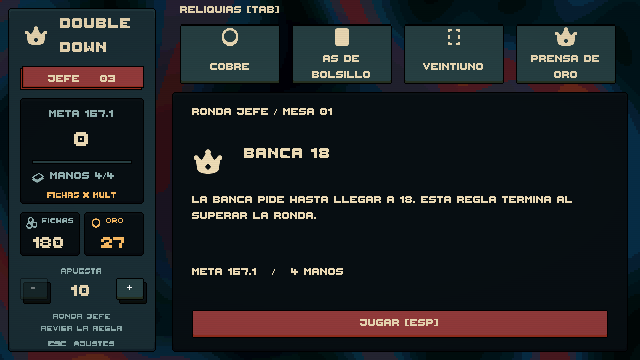

# Rondas jefe — Fase 6

Cada tercera ronda es un jefe; las rondas 1–3 forman la Mesa 1, 4–6 la Mesa 2, etc. Tras salir de la tienda anterior aparece una pantalla con la regla, la meta y las manos disponibles. **Jugar [Esp]** confirma la entrada y entonces se reparte. El aviso no se vuelve a mostrar entre manos de la misma ronda.

## Primer lote funcional

Se implementan tres reglas ya incluidas como ejemplos en el encargo original, con el icono de corona Kenney existente como identificación provisional:

| Jefe | Efecto durante su ronda |
| --- | --- |
| Ases bajos | Los ases del jugador valen siempre 1. También afecta a manos divididas; as + diez vale 11 y no es blackjack. Los ases de la banca conservan su comportamiento habitual. |
| Banca 18 | La banca pide con 17 y se planta al alcanzar 18 o más. Conserva la resolución de blackjack natural. |
| Dos manos | Solo hay dos manos para superar la meta. Dividir conserva la regla existente: consume un reparto, aunque produzca dos manos puntuables. |

La meta conserva la curva de `ScoringBalance.asset`; el jefe no añade un multiplicador oculto. Oro, fichas, equipamiento y secuencia de cartas se conservan al entrar y salir. Al superar el jefe se abre la tienda habitual; la siguiente ronda recupera las reglas y el límite de manos normales. Perder permite reiniciar la run y elimina las restricciones del jefe.

## Datos y extensión

Los assets están en `Assets/Resources/Bosses`. `BossDefinition` contiene ID estable, nombre, descripción, ases bajos, umbral de la banca, máximo de manos y primera mesa de aparición. **Double Down > Boss**, en el menú de creación de assets, permite crear otra definición. Un máximo de manos de 0 conserva el valor de balance. Un jefe debe estar disponible desde la primera mesa; los IDs deben ser únicos.

`BossSchedule` ordena los IDs y selecciona por semilla y número de mesa. Consultar el siguiente jefe no consume el azar del mazo ni de la tienda. Con un conjunto disponible fijo, los tres jefes rotan antes de repetirse. `firstTable` permite incorporar reglas más tarde en la run; los tres iniciales están disponibles desde la Mesa 1.

Se pueden combinar los parámetros existentes creando otro ScriptableObject. Un tipo nuevo de efecto —por ejemplo, anular los bonos de un palo— necesita ampliar el motor y sus pruebas; no está implementado todavía.

`BlackjackSession.ConfigureTable` acepta cambios solo entre manos y no reinicia saldo ni índice de reparto. Cada `BlackjackHand` conserva las reglas con las que fue repartida. `ScoreRun` aplica el límite al iniciar la ronda y expone `HandLimit` al HUD. `BossEncounterView` bloquea el reparto hasta confirmar el aviso y usa el mismo estilo mate que la tienda.

## Verificación

Resultado: **43 pruebas EditMode y 8 PlayMode superadas** en Unity 6000.3.26f1, sin errores ni warnings de compilación C# en estas ejecuciones.

Las pruebas cubren calendario, determinismo y orden del catálogo; disponibilidad por mesa; ases bajos y blackjack de la banca; ases divididos; banca en 18; conservación de saldo y secuencia; agotamiento de dos manos; recuperación de reglas tras ganar o reiniciar. PlayMode recorre ronda 1 → tienda → ronda 2 → tienda → aviso de jefe → ronda 3 → tienda → ronda 4, comprobando que no se reparte antes de aceptar y que desaparece la restricción al salir.

Para probar cada primer jefe, el campo `Run Seed` del controlador admite 20261100 (ases bajos), 20261101 (banca 18) y 20261102 (dos manos). El jefe entra al llegar a la tercera ronda; los valores se pueden ajustar temporalmente en Inspector antes de Play.

La Fase 6 sigue en curso: hay **3 de los 10 jefes mínimos**, 15 reliquias y tienda. Faltan el resto del contenido, consumibles, vales, ediciones/mejoras/sellos jugables y edición de mazo. Este lote necesita simulaciones de balance antes del lanzamiento. No hace falta arte nuevo para probarlo; los iconos finales de jefe siguen pendientes.
