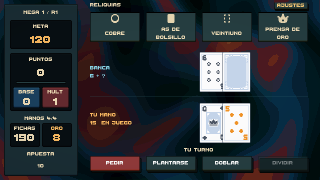
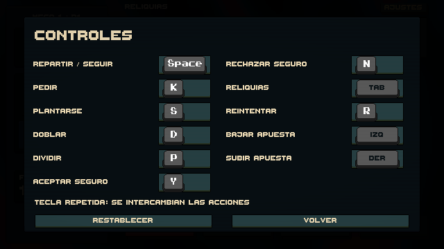

# Legibilidad, controles y respuesta de la mesa

El lateral reúne mesa/ronda, meta, puntos, base y multiplicador, manos restantes, fichas, oro y apuesta. Se retiró el nombre del juego. La fuente bitmap usa tamaños 16 y 32, sin escalado animado del panel. Las cajas numéricas reservan altura suficiente para evitar que Unity recorte los dígitos. Los botones mantienen colores mates y se desplazan un píxel al pasar/pulsar, sin posiciones fraccionarias ni brillo.

## Controles

Abrir **Esc → Controles**, o **Ajustes → Controles** con el ratón. Pulsar una acción y después una tecla. Si ya está asignada, se intercambian ambas acciones. Esc cancela la captura y permanece reservado para cerrar menús. Restablecer recupera los valores iniciales. Las asignaciones se guardan localmente con PlayerPrefs (`controls.bindings.v1`); datos inválidos vuelven a los valores iniciales.

Los botones de la mesa muestran solo acciones. Los gráficos de teclas están en el menú de controles: Gerald's Keys, CC0, del pack suministrado; las teclas sin ilustración utilizan sus teclas vacías con texto. No se activa la acción del juego al asignar una tecla. Se deshabilita la navegación automática del EventSystem para impedir que una misma pulsación active un botón seleccionado y la acción asignada. Esta revisión cubre teclado y ratón; no añade soporte de mando.

## Animaciones

Las cartas salen de la esquina superior derecha, viajan con una curva corta y se voltean durante el reparto. La carta oculta de la banca conserva el dorso hasta revelarse. Al puntuar, las cartas realizan un pulso breve y el contador se acompaña de sonidos ascendentes y una cifra de ganancia. Tienda, catálogo, anuncio de jefe y ajustes entran con un desplazamiento corto en píxeles enteros. Movimiento reducido elimina los desplazamientos y el volteo animado.

## Comprobaciones

Las pruebas cubren intercambio de teclas, serialización, datos inválidos, reserva de Esc, apertura del menú, reasignación y despacho de la acción, además de que los números del HUD generan todos sus glifos. Las suites existentes ejercitan blackjack, puntuación, reliquias, economía, jefes, división y botones sin brillo. Capturas revisadas a resolución lógica 640×360. Resultado: **51 pruebas EditMode y 9 PlayMode superadas**, en Unity 6000.3.26f1. La prueba con teclado virtual configura temporalmente el foco del editor y el procesamiento manual de eventos, y restaura ambos al terminar; no modifica estas preferencias en el juego.

Esta entrega mejora la presentación y añade la base de configuración de controles. No completa la Fase 6 ni la Fase 8: el contenido pendiente sigue registrado en PHASE_6_PROGRESS.md.

