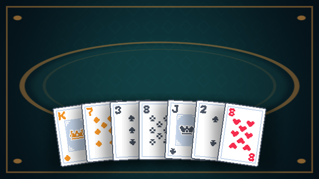

# Entrega de Fase 1

## Hecho

- Escena `FeelSandbox.unity` con 52 sprites de cartas disponibles y siete cartas repartidas al iniciar.
- Hover con giro 2D, sombra dinámica, sway, selección con punch/destellos, arrastre amortiguado, swap, reparto con arco/rebote y flip.
- Abanico suave basado en las curvas de la referencia: siete cartas a escala 2×, centro elevado 0,14 unidades y extremos girados ±8,4°.
- Shader URP original para el fondo geométrico; luz global 2D y shader de tinta que deja los corazones rojos y muestra los diamantes en ámbar.
- Panel compacto de depuración que se abre con `F1`, con scroll, modo de 20 cartas, reducción de movimiento y mute.
- Siete SFX Kenney CC0 con variación de pitch y pools para cartas, destellos y fuentes de audio.
- Corrección justificada de Fase 0: ambas escenas usan Pixel Perfect Camera de URP, no el componente clásico incompatible.
- Prueba de Play Mode: siete cartas activas y boca arriba, escala, abanico, rotación sin perspectiva, tinta y shader de fondo.

## Abrir y probar

1. Si Unity ya tenía `Bootstrap.unity` abierto antes de esta entrega, vuelve a abrir una escena desde Project para cargar su versión nueva guardada en disco.
2. Abre `Assets/_Game/Scenes/FeelSandbox.unity`, pulsa Play y espera aproximadamente un segundo al reparto.
3. Prueba los controles de `FEEL_SANDBOX.md`; pulsa `F1` para abrir los sliders.
4. En Test Runner, ejecuta `DoubleDown.Tests.PlayMode > SandboxDealsSevenFaceUpCards`.

## Checklist manual

- [ ] Al iniciar se reparten siete cartas con arco, rebote, flip y sonidos escalonados.
- [ ] Hover eleva, escala, gira suavemente en el plano y desplaza la sombra sin saltos visibles.
- [ ] Corazones rojos y diamantes ámbar se distinguen; los naipes se ven completos y sin deformación 3D.
- [ ] El fondo muestra figuras geométricas nítidas y no presenta artefactos.
- [ ] Clic corto selecciona/deselecciona con punch y destellos.
- [ ] Arrastrar sigue al cursor con retraso amortiguado; al soltar vuelve al abanico.
- [ ] Al cruzar otras cartas, el orden cambia una sola vez por cruce y las cartas vecinas se recolocan.
- [ ] `F`/`Enter` voltea la carta enfocada o seleccionada.
- [ ] `R`, `T` y `D` recrean la mano sin errores de consola.
- [ ] Los sliders actúan en vivo; reducción de movimiento y mute funcionan.
- [ ] En Game View 16:9 y ultrawide no hay deformación; aparecen barras cuando corresponde.
- [ ] El Profiler alcanza 60 FPS estables con 20 cartas en el equipo objetivo.

## Verificación automatizada

Compilación en Unity 6.3.26f1. Play Mode Test Runner: 1 prueba ejecutada, 1 superada. El test valida reparto, revelación, escala, curva, rotación, material de tinta y shader del fondo. Se inspeccionó una captura RenderTexture de 640×360.

## Problemas conocidos y alcance

- El resultado táctil, audio percibido y 60 FPS todavía necesitan tu evaluación manual. No se pueden certificar mediante el test de reparto.
- La UI de depuración es IMGUI temporal. Los sprites de Kenney son cuadrados; los marcos de naipe final no existen todavía.
- `Bootstrap.unity` puede quedar con su versión antigua en memoria si Unity estaba abierto al actualizar archivos externos; abrir la escena de nuevo carga la cámara URP corregida.
- Las reglas de blackjack, puntuación y contenido de tienda pertenecen a fases posteriores.

## Assets para Fase 2

**Ningún archivo nuevo obligatorio.** El núcleo de blackjack puede usar los naipes y SFX ya incluidos, con UI de prueba generada con componentes de Unity. Si quieres sustituir arte/audio temporal, la convención será `UI_ActionHit.png`, `UI_ActionStand.png`, `UI_ActionDouble.png`, `UI_ActionSplit.png`, `UI_ActionInsurance.png` (cada uno 96×32 px, PNG RGBA) y `SFX_ActionHit.ogg`, `SFX_ActionStand.ogg`, `SFX_ActionDouble.ogg`, `SFX_ActionSplit.ogg`, `SFX_ActionInsurance.ogg` (OGG mono, 48 kHz, ≤0,5 s). No se definirá ningún ítem ni reliquia sin presentarte antes su efecto y pedirte el icono.
