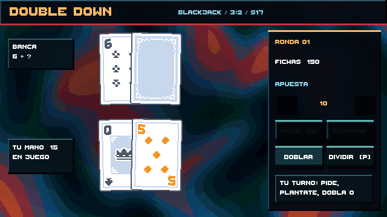

# Entrega de Fase 2 — núcleo de blackjack

## Hecho

- Mazo de 52 cartas, barajado determinista y pruebas con orden de robo preparado.
- Valor de manos con varios ases, blackjack natural, banca en 17 blando, pago 3:2, seguro 2:1, pedir, plantarse, doblar y dividir.
- Máquina de estados de turno, apuestas con reserva de fichas, dos manos tras dividir y eventos tipados para la presentación.
- Escena `BlackjackTable.unity` con cartas Kenney, fondo pixelado, reverso oculto de la banca, fuente bitmap Thaleah, botones y atajos de teclado. La interfaz se dibuja en el espacio lógico de 640×360 y deja visibles las cartas.
- Configuración `BlackjackRules.asset` editable sin cambiar código. Las animaciones de reparto reutilizan el material de tinta de la Fase 1.

## Abrir y probar

1. Abre `Assets/_Game/Scenes/BlackjackTable.unity` en Unity 6.3.26f1 y pulsa Play. La primera ronda se reparte sola.
2. Usa los botones o las teclas: `H` pedir, `S` plantarse, `D` doblar, `P` dividir, `Y` aceptar seguro, `N` rechazar seguro y `Espacio` repartir la siguiente ronda.
3. Entre rondas cambia la apuesta con `-` y `+`. El perfil de reglas está en `Assets/_Game/Settings/BlackjackRules.asset`.
4. En Test Runner ejecuta las suites EditMode y PlayMode de `DoubleDown.Tests`.

## Pruebas manuales

- [ ] La banca muestra una carta y mantiene la segunda boca abajo hasta resolver la mano.
- [ ] Los botones deshabilitados no permiten acciones: dividir sin pareja, doblar sin fichas o pedir fuera de turno.
- [ ] Un as puede valer 11 o 1; el total mostrado coincide con la mano.
- [ ] Al dividir aparecen dos manos; tras terminar la primera se activa la segunda.
- [ ] Al doblar se descuenta otra apuesta, se recibe una carta y termina esa mano.
- [ ] Con as visible de la banca se ofrecen las dos opciones de seguro antes de jugar.
- [ ] La banca se planta en 17 blando; blackjack natural paga 3:2; victoria, derrota y empate actualizan las fichas.
- [ ] En 16:9 y ultrawide la cámara mantiene el pixel art sin deformar las cartas ni cortar los botones.
- [ ] No hay errores ni warnings de C# en la consola; los SFX se oyen sin picos molestos.

## Verificación automatizada

Unity 6.3.26f1: 12 pruebas EditMode de reglas y mazo, 2 pruebas PlayMode de escenas e interacción, todas superadas. La prueba de mesa comprueba que el botón «Pedir» recibe raycasts y añade una carta. Se inspeccionó una captura RenderTexture de 640×360.

## Alcance y límites

La puntuación y las metas se implementaron en la Fase 3; consulta `PHASE_3_DELIVERY.md`. La tienda, las reliquias, el guardado y la economía de run corresponden a fases posteriores. El rendimiento a 60 FPS y las sensaciones de audio/animación deben confirmarse manualmente en el equipo objetivo.

## Assets para Fase 3

No hay archivos obligatorios para empezar: se pueden generar placeholders identificados como `PH_`. La lista exacta de reemplazos opcionales está en `ASSETS_PHASE_2_3.md`; no bloquea la implementación.
