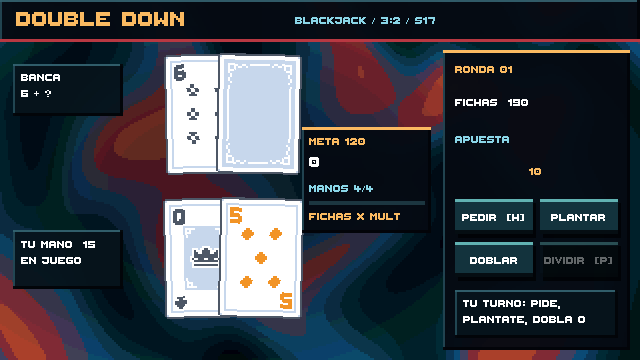

# Entrega de Fase 3 — puntuación incremental

## Jugar

Abre `Assets/_Game/Scenes/BlackjackTable.unity` en Unity 6 y pulsa Play. La meta y las manos disponibles aparecen entre las cartas y el panel de acciones. Cada mano de blackjack resuelta consume una oportunidad. La puntuación de las manos ganadas, empatadas o con blackjack se suma a la meta. Si la alcanzas, pulsa **Siguiente** para pasar a la próxima ronda; si agotas las manos, pulsa **Reintentar** para empezar una run nueva.

El cálculo inicial es `fichas = total de la mano + 5 × cartas + apuesta / 2`. El multiplicador es 2 al ganar, 3,5 con blackjack natural, 0,5 al empatar y 0 al perder. Una división suma ambas manos, pero consume una sola oportunidad. Todo se configura en `Assets/_Game/Settings/ScoringBalance.asset`. La primera meta es 120, crece ×1,18 por ronda y se conceden 4 manos.

La puntuación usa `BigNumber` con mantisa y exponente decimal. La animación de conteo y la barra de progreso muestran el mismo valor; las cifras grandes usan K, M, B, T y notación científica. La mesa sigue usando apuestas enteras de blackjack, independientes de la puntuación de la run.

## Presentación

La interfaz usa la fuente bitmap **Thaleah** de Tiny Worlds, descargada previamente de la [Unity Asset Store](https://assetstore.unity.com/packages/2d/fonts/free-pixel-font-thaleah-140059), con atlas filtrado por punto. Los botones se elevan al pasar el cursor, se hunden al presionar, muestran profundidad y brillo, y reproducen un clic con ligera variación de tono. Los controles deshabilitados se atenúan. El fondo conserva franjas de color animadas sin singularidad central; una puntuación lo ilumina brevemente.

## Verificación

- 15 pruebas EditMode: reglas de blackjack, número grande, fórmula, límites de manos y crecimiento de meta.
- 4 pruebas PlayMode: carga de escena, reparto y raycast de botones, resolución y puntuación, avance de ronda, respuesta al hover y al clic.
- Capturas RenderTexture a 640×360 revisadas para comprobar legibilidad, disposición, fondo y controles activos.
- [Simulación de balance](BalanceSimulation.md): 1.000 runs deterministas con una estrategia simple; 58,1 % superan la primera ronda, 52,0 % de los que llegan superan la segunda. Sirve de línea base antes de añadir reliquias.

## Alcance

El balance se ajustará de nuevo cuando existan reliquias y mejoras. La simulación no modela una estrategia óptima. La prueba automatizada verifica los estados de hover y pulsación; el tacto final del audio y la respuesta a 60 FPS requieren una pasada manual en Windows.
