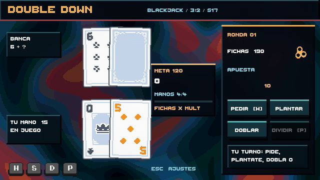
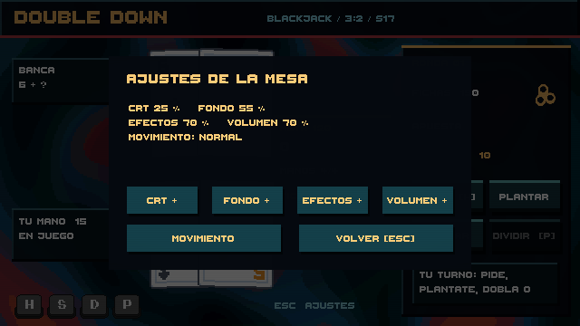

# Fase 4 — presentación y assets nuevos

La mesa incorpora un CRT ligero (líneas y viñeta, sin deformación geométrica ni desenfoque), estados de victoria/derrota del fondo y dos acabados de carta. El acabado frío destaca una victoria y el dorado un blackjack natural. Se aplica solamente al papel claro; los valores y palos conservan su tinta. Estos acabados son feedback visual y no modifican las reglas.

Pulsa **Esc** para abrir los ajustes. Puedes graduar CRT, velocidad del fondo, intensidad de efectos y volumen, o activar movimiento reducido. Los botones de nivel avanzan en pasos de 25 puntos hasta 100 % y vuelven a cero. Las preferencias se conservan localmente mediante PlayerPrefs. El panel bloquea clics y atajos de la mesa y pausa su avance mientras está abierto.

## Recursos integrados

| Pack suministrado | Uso | Licencia incluida |
| --- | --- | --- |
| Gerald's Keys | Indicadores H/S/D/P con estados normal y pulsado | CC0 |
| Kenney UI Audio | Clic, hover y pulsos de puntuación separados | CC0 |
| Kenney Board Game Icons | Icono de fichas junto al saldo | CC0 |

Se incluyen los textos originales de licencia en `Assets/Resources/TablePresentation`. El pack de cartas ya estaba integrado. Complete UI Essential Pack se revisó, pero no se incorporó: sus paneles no aportaban una mejora clara a esta mesa. Los shaders son código del proyecto.

## Verificación y coste

Cinco pruebas PlayMode verifican la mesa, puntuación, botones, recursos y bloqueo modal de los ajustes. Se revisaron capturas de la mesa y ajustes a 640×360. El CRT usa una sola capa UI sin RenderTexture intermedia; la tinta comparte material entre cartas y varía con MaterialPropertyBlock. Las teclas reutilizan sus dos sprites y los liberan al destruirse, al igual que los materiales instanciados.

Esto no sustituye una medición de 60 FPS en una build de Windows: el perfilado de GPU y la optimización final siguen pendientes. No se añade todavía curvatura CRT, aberración cromática ni ediciones con efectos de juego.

Para reconstruir los importadores y el material CRT: `Double Down > Phase 4 > Build Presentation`.
