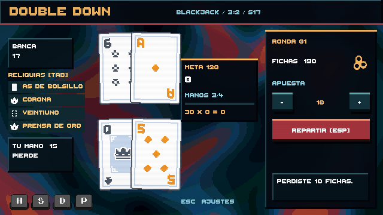
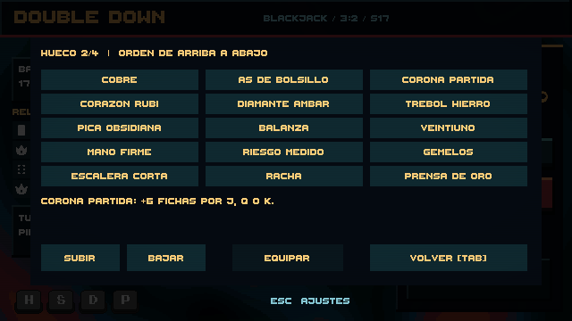

# Fase 5 — reliquias aprobadas

Se implementaron las 15 reliquias de la propuesta aprobada, con cuatro huecos y un catálogo para experimentar con builds antes de añadir la tienda. Pulsa **Tab** o una reliquia de la mesa para abrirlo. Elige una reliquia, revisa su efecto y pulsa **Equipar**. **Subir** y **Bajar** intercambian el hueco seleccionado con su vecino. Cada reliquia puede equiparse una sola vez y los cambios solo se permiten entre manos.

El orden visible es de arriba a abajo y se aplica antes de sumar los puntos a la meta. La Prensa de oro multiplica el multiplicador acumulado: colocar Veintiuno antes de ella produce más puntos que colocarlo después. La racha cuenta manos ganadas (incluidas las divididas); un empate la conserva y una derrota la reinicia. Las manos perdidas no reciben puntos de reliquias. El saldo de apuestas no cambia por estos efectos.

Las activaciones se iluminan secuencialmente en la lista. El multiplicador también utiliza BigNumber. Los efectos se configuran en los 15 ScriptableObjects de `Assets/Resources/Relics`: disparador, operación, cantidad, palo e icono. Se pueden añadir combinaciones de esos disparadores desde el menú de creación de assets sin tocar código; un disparador nuevo requiere ampliar el motor.

Los iconos provisionales proceden de Kenney Board Game Icons (CC0), suministrado por el usuario. Se mantienen los créditos y la licencia en `Assets/Resources/TablePresentation/Icons/License.txt`.

## Verificación

33 pruebas EditMode y 6 PlayMode superadas. Incluyen las 15 condiciones de reliquia sobre una mano conocida, orden aditivo/multiplicativo, duplicados, pérdidas sin puntos, bloqueo durante la mano, equipamiento y reordenado desde la interfaz. Se revisaron capturas a 640×360.

El catálogo ofrece acceso libre para probar efectos; adquisición, precios, tienda y progreso de inventario pertenecen a la Fase 6. El equipamiento todavía no se guarda entre sesiones. La simulación de balance de Fase 3 sigue siendo una referencia sin reliquias y debe ampliarse al incorporar economía y tienda.

Para crear el catálogo en un proyecto nuevo: `Double Down > Phase 5 > Build Relic Catalog`. No sobrescribe definiciones que ya existan.
