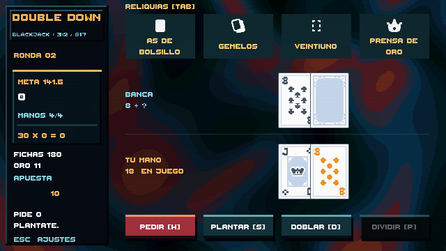
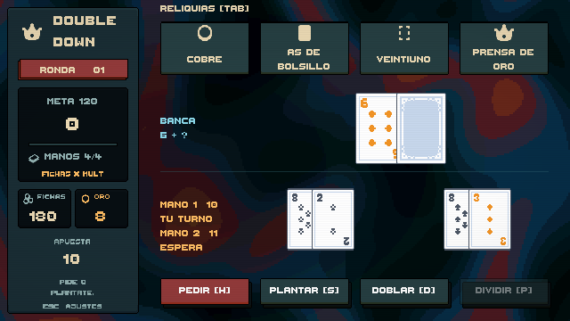
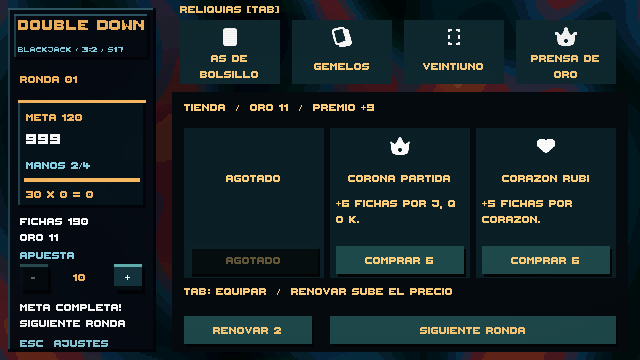

# Mesa reorganizada y Fase 6 en curso

La revisión posterior del lateral y los botones está documentada en [UI_POLISH.md](UI_POLISH.md), con los nuevos assets y sus créditos.

## Distribución revisada

La mesa usa una cuadrícula lógica de 640×360. La columna izquierda reúne ronda, meta, puntuación, manos, fichas, oro y apuesta. Las cuatro reliquias ocupan una fila superior y se resuelven de izquierda a derecha. La banca y el jugador tienen dos bandas independientes; las acciones permanecen en la banda inferior. Se retiraron las indicaciones de teclado duplicadas y se redujo la luminosidad del fondo procedural para mejorar el contraste.

`TableLayout.cs` define las zonas y la separación de cartas. Las manos largas comprimen su separación dentro de su propia banda; una división crea dos grupos y distingue «TU TURNO», «ESPERA» y «PLANTADA». Las cartas de la mesa se presentan rectas y más pequeñas para conservar la lectura y dejar espacio a la build. El sandbox de interacción sigue siendo una escena independiente.

La tienda sustituye el área central de juego entre rondas, manteniendo visibles la información de la run y las reliquias. El catálogo y los ajustes aparecen por encima de la tienda cuando se abren.

## Tienda y economía implementadas

- Al superar la meta, **Tienda [Esp]** abre tres ofertas de reliquias aún no adquiridas. **Siguiente ronda** cierra la tienda y reparte la siguiente mano.
- El oro es independiente de las fichas apostadas. La configuración inicial concede 8 de oro; una ronda superada concede `6 + número de ronda + manos sobrantes`. La recompensa solo se concede una vez por ronda.
- Cada reliquia cuesta 6. Comprar descuenta el precio, añade la reliquia al inventario de la run y agota esa oferta. **Tab** abre el catálogo para equipar las adquiridas. Las cuatro reliquias iniciales se conservan como conjunto de partida.
- Renovar cuesta 2 inicialmente y aumenta en 1 tras cada renovación. El precio se reinicia en la siguiente tienda. No se cobra si faltan fondos o si ya se posee todo el catálogo.
- Las ofertas no incluyen duplicados ni reliquias ya adquiridas. Se generan con una semilla separada del RNG visual y derivada de la semilla configurada de la run.
- Al reiniciar tras perder se restablecen oro, inventario, ofertas y equipamiento inicial. El inventario todavía no se guarda al cerrar el juego.

## Rondas jefe integradas

Cada tercera ronda incorpora una de tres reglas: ases bajos, banca en 18 o dos manos. Se anuncia antes del reparto y se retira al pasar de ronda. Consulta [BOSSES.md](BOSSES.md) para configuración, pruebas y límites.

## Archivos y configuración

`Assets/Resources/EconomyBalance.asset` contiene oro inicial, precio de reliquia, coste inicial e incremento de renovación, premio base y oro por mano sobrante. `EconomyBalanceConfig` convierte esos datos en reglas de dominio. `RunEconomy` aplica las transacciones sin depender de la UI. `RunShop` presenta las ofertas y actualiza el HUD; `BlackjackTableController` enlaza victoria, tienda y siguiente ronda.

También se modificaron `RelicRack` (fila horizontal y equipamiento limitado al inventario), `TablePresentation` (orden de ventanas), `CasinoVortex.shader` (luminosidad), y las pruebas EditMode/PlayMode. La escena `BlackjackTable` construye el HUD al iniciar; no es necesario reconstruirla para ver esta distribución.

## Cómo probar

1. Abrir `Assets/_Game/Scenes/BlackjackTable.unity` y pulsar Play.
2. Comprobar que las cartas, los totales, la columna izquierda y los botones están separados. Probar pedir varias cartas y dividir una pareja cuando esté disponible.
3. Abrir **Tab**, seleccionar una reliquia no adquirida y comprobar que no se permite equiparla. Durante una mano tampoco se permiten cambios en el equipamiento.
4. Superar una meta, abrir **Tienda [Esp]**, comprar y comprobar el descuento de oro y la oferta agotada. Usar **Tab** para equiparla entre manos.
5. Renovar ofertas, comprobar el incremento de precio y continuar. En la siguiente tienda, verificar que el precio vuelve al inicial y las reliquias adquiridas no se ofrecen.
6. Abrir y cerrar **Esc** y **Tab** desde la tienda. Comprobar que los controles de la mesa quedan tapados por el panel central y las ventanas abiertas reciben el input.

## Verificación y límites

Las pruebas automatizadas comprueban transacciones deterministas, recompensa única, precios configurables, premio por manos sobrantes, coste creciente, agotamiento de catálogo, reinicio, bloqueo de equipamiento y continuidad a la siguiente ronda. La distribución se comprueba con manos de hasta once cartas y una división real en PlayMode. Se revisan capturas de mesa, división, catálogo y tienda a 640×360. Resultado tras integrar los jefes: **43 pruebas EditMode y 8 PlayMode superadas** en Unity 6000.3.26f1. Sin errores ni warnings de compilación C# en los registros de estas ejecuciones. La prueba del sandbox espera ahora a que termine el giro de las cartas, con un tiempo máximo, para evitar fallos por la duración de un frame en batch mode.

La Fase 6 **no está completa**. Falta ampliar los jefes de 3 a 10, además de consumibles, vales, edición de mazo, efectos jugables de ediciones/mejoras/sellos y la ampliación de contenido hasta los mínimos del encargo. El balance de economía es inicial y necesita simulaciones con builds; aún no es balance de lanzamiento. El guardado y la metaprogresión corresponden a la Fase 7. Las pruebas actuales no certifican rendimiento sostenido a 60 FPS ni una build de producción.

No hacen falta nuevos assets para este tramo: utiliza los 15 iconos provisionales aprobados y el audio suministrado. Los próximos lotes de objetos necesitan propuesta de efectos e iconos antes de incorporarse; no se han inventado nuevos ítems ni arte final.
