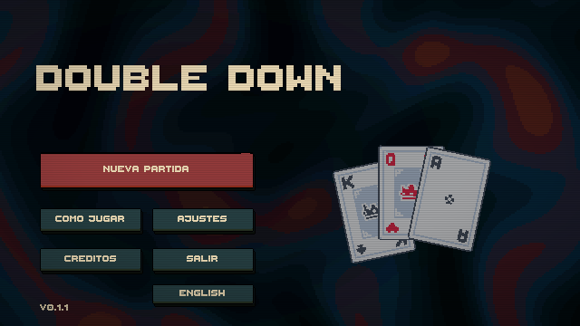
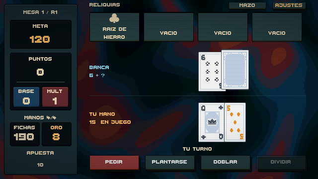
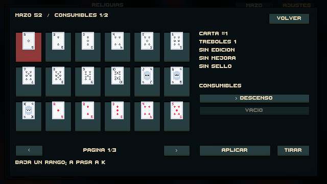

# DOUBLE DOWN 0.1.1 — entrega de portfolio

Fase 6 terminada: el ciclo permite jugar blackjack, puntuar, comprar, modificar el mazo, enfrentarse a jefes, perder, revisar el resultado y reintentar. Se añadieron menú principal, ayuda, créditos, ajustes de pantalla y confirmación para salir de una run activa.

## Calidad comprobada

- Unity 6000.3.26f1: **62 EditMode y 13 PlayMode**, sin fallos. Se probaron catálogos completos, selección inicial, compras, capacidad de reliquias, consumo, mazo, jefes, menús, derrota, reintento, cambio de idioma, controles y vuelta al menú.
- 2.000 runs simuladas antes del cambio de reliquia inicial de 0.1.1, 1.000 con compras y 1.000 sin compras. Ningún bloqueo; informe en PHASE_6_SIMULATION.md. La política automática es simple y no certifica el balance actual.
- Build Windows x64 completada: **0 errores, 0 advertencias**, 105.419.302 bytes según Unity. `PORTFOLIO_BUILD_RESULT.txt` conserva el resultado.
- Se abrió el ejecutable en Windows y se comprobó visualmente menú y mesa a 1280×720, clic de Pedir, ajustes, controles y pantalla completa/ventana. El registro del ejecutable no mostró excepciones. El regreso al menú, reintento y teclado reasignado están cubiertos por PlayMode; la herramienta de inyección de teclado del control de escritorio no hizo llegar pulsaciones de tecla al ejecutable, por lo que la comprobación humana con teclado físico queda en la lista manual.
- Capturas revisadas de menú, ayuda, tienda, mazo, colección y derrota a resolución lógica 640×360; la ventana nativa muestra escalado entero a 1280×720.

## Checklist manual antes de publicar

1. Extraer el ZIP en otra carpeta y abrir DoubleDown.exe. Probar con teclado físico H/S, Esc y reasignación de Pedir; guardar y relanzar para comprobar persistencia. Probar clics y activar pantalla completa, después volver a ventana.
2. Hacer una run sin ayudas de test: superar una meta, comprar una reliquia, un vale y un consumible, aplicarlo al mazo y cerrar el catálogo. Confirmar que la banca y el jugador reciben cartas del mazo modificado en las manos siguientes.
3. Llegar a jefe de ronda 3 y confirmar retirada de su regla en ronda 4. Perder, revisar resumen, reintentar y volver al menú con su confirmación.
4. Mirar legibilidad en monitor 16:9 y ultrawide. El arte de contenido es provisional.

## Límites honestos

Versión de portfolio jugable, en desarrollo. La interfaz y las explicaciones de efectos cambian entre español e inglés; los nombres propios de objetos permanecen en español. No hay guardado de runs, metaprogresión ni logros; se abordarán en Fase 7. No hay música de fondo incorporada; los SFX funcionan. El balance es inicial y se pulirá en Fase 9. Iconos PH_ de los packs aprobados reemplazables sin cambiar datos. La build no declara rendimiento sostenido a 60 FPS sin perfilado en hardware adicional.

## Archivos y prueba

Escenas `MainMenu.unity` y `BlackjackTable.unity`. Abrir MainMenu y Play. Menú Unity **Double Down → Portfolio → Build Windows x64** reconstruye la escena inicial y exporta `Builds/DoubleDown-0.1.1-Windows-x64`. `python tools/package_itch.py` prepara el ZIP. Los efectos aprobados y requisitos exactos de PNG están en PHASE_6_CONTENT_PROPOSAL.md; instrucciones de publicación en ITCH_IO_RELEASE.md. No se requieren nuevos assets para jugar esta versión. Los reemplazos futuros de iconos PH_ se indican como PNG RGBA 32×32 con el mismo nombre.

