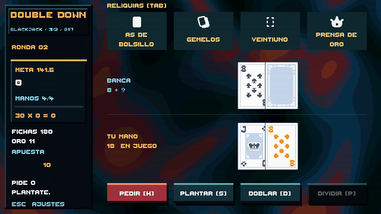
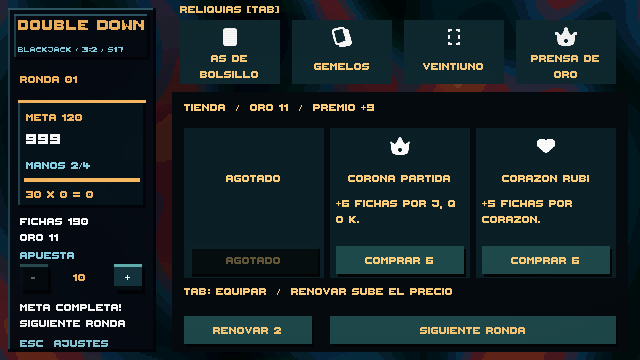

# Revisión del lateral y los botones

El lateral de la mesa utiliza ahora marcos pixel art del pack suministrado por el usuario. El título y el emblema forman una cabecera; la ronda tiene una banda propia, la puntuación ocupa el bloque principal y fichas y oro se muestran en dos contadores separados. La apuesta y las indicaciones permanecen debajo. Se conserva la distribución de cartas y las zonas reservadas de 640×360.

Se han retirado las capas de brillo de los botones y su aclarado al pasar el cursor. Mesa, tienda, catálogo y ajustes comparten superficies mates. Hover y pulsación desplazan el botón un píxel; la escala del texto permanece fija. El audio se mantiene y «Movimiento reducido» desactiva ese desplazamiento. Las reliquias señalan su activación con un pequeño movimiento del icono, sin iluminar el fondo del botón.

## Assets integrados

En `Assets/Resources/TablePresentation/Chrome`:

| Archivo en el proyecto | Original del pack |
| --- | --- |
| Frame.png | UI_Flat_Frame01a.png |
| Button.png | UI_Flat_Button01a_1.png |
| Banner.png | UI_Flat_Banner03a.png |
| Progress.png | UI_Flat_Bar01a.png |

Autor: **Crusenho Agus Hennihuno**, [Crusenho](https://crusenho.itch.io). Pack: Complete UI Essential Pack Free, facilitado por el usuario. Licencia [CC BY 4.0](https://creativecommons.org/licenses/by/4.0/). Los PNG se conservan sin modificar; se renombran y se aplican tintes y escalado de nueve segmentos en tiempo de ejecución. Se incluyen `License.txt` y `Credits.txt` junto a los recursos. Los iconos de corona, cartas y monedas proceden del pack Kenney Board Game Icons ya integrado (CC0).

`CasinoUiSkin` centraliza los colores y aplica los sprites. Importación Point, sin mipmaps ni compresión; las esquinas mantienen su grosor al cambiar las dimensiones de un panel. No se necesita arte adicional para esta revisión.

## Verificación

Se revisan capturas de mesa normal, manos divididas, tienda, catálogo y ajustes a 640×360. La prueba de interacción comprueba que hover y pulsación conservan el color y la escala del botón, que ya no existe la capa de brillo y que se mantiene el desplazamiento al pulsar. La suite PlayMode pasa sus **7 pruebas**, incluidas tienda, equipamiento y distribución de manos; sin errores ni warnings de compilación C# en esta ejecución. Los cálculos de blackjack y economía no se han modificado en esta revisión.

Para probarlo: abrir `BlackjackTable.unity`, pasar el cursor y pulsar las acciones, abrir **Tab** y **Esc**, y entrar en la tienda tras superar una ronda. El estado de la Fase 6 se mantiene: esta revisión es de presentación, sin nuevas reglas ni objetos.

## Revisión posterior: lateral y controles

La revisión actual sustituye la cabecera de marca por datos de partida, elimina el escalado del lateral, corrige cajas numéricas recortadas y añade controles reasignables y nuevas animaciones. Véase [CONTROLS_AND_FEEL.md](CONTROLS_AND_FEEL.md) para comportamiento, pruebas y capturas actuales.
